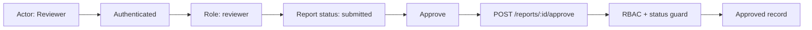

# AI가 만든 PoC를 제품 스펙으로 번역하는 법

비개발팀의 바이브 코딩 결과물을 유저플로우, 유즈케이스, 유저저니, QA, 제품 병합 계획으로 바꾸는 실전 프로세스

초안 v0.1

---

## 들어가며

AI가 코드를 쓰기 시작하면서 제품 개발의 입구가 넓어졌다.

이제 개발팀이 아니어도 아이디어를 화면으로 만들 수 있다. 고객지원팀은 고객 불편을 보고 간단한 대시보드를 만든다. 운영팀은 반복 업무를 줄이려고 내부 도구를 만든다. 비즈니스팀은 고객 미팅 직후 "이런 기능이 있으면 팔릴 것 같다"는 감각으로 데모 앱을 만든다. 이전에는 기획서, 와이어프레임, 회의록으로만 남았을 아이디어가 이제는 실제로 클릭되는 코드와 화면이 된다.

이 변화는 아주 좋은 소식이다. 아이디어가 말에서 멈추지 않고 움직이는 형태가 되기 때문이다. 그러나 동시에 새로운 문제가 생긴다.

작동하는 PoC가 곧 제품 스펙은 아니다.

PoC는 가능성을 보여준다. 하지만 제품은 반복해서 쓰이고, 테스트되고, 유지보수되고, 운영되고, 장애 상황에서도 설명 가능해야 한다. PoC에는 화면이 있지만 역할 구분이 없을 수 있다. 버튼은 있지만 클릭 후 상태가 기록되지 않았을 수 있다. 결과물은 보이지만 저장되는지, 누구에게 전달되는지, 언제 폐기되는지 알 수 없을 수 있다. AI 호출은 있지만 품질 기준, 리뷰 기준, 실패 처리, 비용 정책이 빠져 있을 수 있다.

이 책은 그 간극을 다룬다.

우리가 해결하려는 문제는 "AI로 코드를 더 빨리 쓰는 법"이 아니다. 이미 코드는 빨라졌다. 더 중요한 문제는 빠르게 만들어진 기능 후보를 제품 조직이 믿고 이어받을 수 있는 스펙으로 번역하는 것이다.

여기서 다루는 방법은 `feature-intake`라는 작업 흐름으로 구현된다. 핵심은 간단하다.

1. 프론트엔드와 소스 코드에 존재하는 액션을 모두 수집한다.
2. 실제 브라우저에서 페이지, 상태, 버튼 반응, 모달, 에러, 출력 상태를 캡처한다.
3. 수집한 증거를 `action graph`로 정규화한다.
4. 유저플로우, 유저저니, 유즈케이스, 화면별 기능 설명을 그래프에서 파생한다.
5. 자체 검수 리포트로 빠진 흐름과 불확실한 결정을 드러낸다.
6. 사용자가 확인하고, 확인 결과를 다시 그래프에 반영한다.

이 책은 이 프로세스가 왜 필요한지, 어떤 문제를 해결하는지, 어떻게 AI 활용 사례로 설명할 수 있는지, 그리고 조직 안에서 어떻게 재현 가능한 안전망으로 만들 수 있는지를 정리한다.

---

## 1장. 문제는 코드가 아니라 해석이다

AI 시대의 첫 번째 착각은 "코드가 있으면 요구사항도 있는 것"이라고 생각하는 것이다.

실제로는 반대인 경우가 많다. 바이브 코딩으로 만든 결과물은 화면과 동작을 갖고 있지만, 그 동작이 어떤 제품적 의미를 갖는지는 분리되어 있지 않다. 코드는 말 그대로 구현의 흔적이다. 그 안에는 중요한 정보도 있지만, 제품팀이 필요한 형태로 정리되어 있지는 않다.

예를 들어 어떤 PoC에 `분석 시작` 버튼이 있다고 하자. 이 버튼 하나에도 다음 질문이 숨어 있다.

- 누가 이 버튼을 누르는가?
- 버튼을 누르기 전 필요한 입력은 무엇인가?
- 누른 직후 로딩 상태는 어떤가?
- 실패하면 사용자는 무엇을 보게 되는가?
- 결과는 임시 결과인가, 저장되는 공식 기록인가?
- 결과를 수정할 수 있는가?
- 수정하면 원본은 보존되는가?
- 결과를 누가 검토하고 승인하는가?
- 복사, 다운로드, 전송 중 무엇이 제품의 실제 출력인가?
- 운영자가 장애를 추적할 수 있는가?

PoC 코드에는 이 질문들의 일부가 숨어 있다. 일부는 화면에 보인다. 일부는 전혀 없다. 문제는 이 정보들이 흩어져 있다는 것이다.

개발팀이 이런 PoC를 바로 제품에 병합하려고 하면 흔히 다음 문제가 생긴다.

- 버튼은 옮겼지만 클릭 후 모달이 빠진다.
- 화면 제목은 유지됐지만 데이터 풍부함이 사라진다.
- AI 결과는 나오지만 재생성, 편집, 적용, 취소 흐름이 빠진다.
- 복사 버튼은 있지만 저장, 감사, 이력, 권한의 의미가 정의되지 않는다.
- QA는 해피패스만 확인하고 예외 상태를 놓친다.
- 제품팀은 "PoC와 비슷하다"고 느끼지만 실제 유저 여정은 달라진다.

이것은 개발 역량 부족의 문제가 아니다. 입력물이 제품 스펙의 형태가 아니기 때문에 생기는 번역 손실이다.

따라서 필요한 것은 더 많은 코드 생성이 아니라, 더 나은 스펙 추출이다.

---

## 2장. 비개발팀의 바이브 코딩이 만든 새로운 업무

바이브 코딩은 제품 조직의 역할 경계를 바꾸고 있다.

예전에는 비개발팀이 아이디어를 만들면 개발팀은 그 아이디어를 해석해서 구현했다. 중간 산출물은 보통 문서였다. 문서는 불완전했지만, 적어도 "무엇을 하려는지"를 설명하려고 했다.

지금은 다르다. 비개발팀이 AI와 함께 바로 화면을 만든다. 버튼을 배치하고, 간단한 상태를 만들고, 더미 데이터를 넣고, 외부 API를 붙이고, 어느 정도 그럴듯한 결과 화면까지 만든다. 이 결과물은 문서보다 생생하다. 그러나 생생하다고 해서 명확한 것은 아니다.

새로운 업무는 다음과 같다.

첫째, PoC를 제품 후보로 해석해야 한다.

PoC에는 실험적 코드, 임시 데이터, 과장된 UI, 하드코딩된 시나리오가 섞여 있다. 어떤 것은 제품으로 가져와야 하고, 어떤 것은 버려야 한다. 어떤 것은 지금은 수동 운영으로 충분하고, 어떤 것은 반드시 자동화해야 한다.

둘째, 화면을 흐름으로 바꿔야 한다.

제품은 단일 화면이 아니라 사용자가 목표를 달성하는 경로다. 한 페이지의 캡처만으로는 부족하다. 입력 전, 입력 후, 로딩, 결과, 실패, 수정, 저장, 전송, 검토 상태가 모두 흐름의 일부다.

셋째, 코드의 액션을 제품의 의미로 바꿔야 한다.

`handleSubmit`, `onGenerate`, `copyToClipboard`, `approveResult` 같은 함수 이름은 단서일 뿐이다. 스펙이 되려면 누가, 언제, 왜, 어떤 결과를 기대하고, 실패하면 어떻게 되는지가 붙어야 한다.

넷째, 합의가 필요한 결정을 숨기지 말아야 한다.

AI가 쓴 문서는 자연스럽게 보이기 쉽다. 하지만 자연스러운 문장이 위험할 때가 있다. 모르는 것을 아는 것처럼 쓰면 조직은 잘못된 확신을 얻는다. 스펙 추출의 목적은 빈칸을 감추는 것이 아니라, 빈칸을 정확히 드러내는 것이다.

---

## 3장. 우리가 만들려는 것은 안전망이다

`donghyuns-agent-tools`의 기본 철학은 "더 많이 생성하는 도구"가 아니라 "손실을 막는 안전망"이다.

이 작업도 같은 철학 위에 있다.

비개발팀이 만든 PoC에서 제품팀과 개발팀이 잃기 쉬운 것은 다음이다.

- 공유 이해의 손실
- 버튼 반응과 상태의 손실
- 원래 PoC가 담고 있던 데이터 풍부함의 손실
- 예외 경로와 운영 요구사항의 손실
- 테스트 가능한 요구사항의 손실
- 의사결정이 필요한 질문의 손실

안전망은 이 손실을 줄여야 한다.

따라서 좋은 feature intake 결과물은 "그럴듯한 분석 보고서"가 아니다. 좋은 결과물은 다음 성질을 가진다.

- 모든 중요한 주장은 증거가 있다.
- 증거가 없으면 `assumed`, `unknown`, `decision-needed`, `blocked`로 표시된다.
- 모든 주요 버튼과 액션은 반응 상태가 기록된다.
- 모든 유저플로우 단계는 화면, 코드, 액션 ID 중 하나에 연결된다.
- 모든 유즈케이스는 정상 경로와 예외 경로를 갖는다.
- 모든 출력물은 저장, 복사, 다운로드, 전송, 임시 표시 중 어떤 의미인지 분리된다.
- 마지막에는 사용자가 검토해야 할 질문이 남는다.

이런 결과물은 단순 문서가 아니라 다음 작업의 입력이 된다.

- 테스트 코드 작성
- QA 시나리오 생성
- 메인 서비스 병합 범위 결정
- MVP 백로그 분리
- 데이터 모델과 API 설계
- 운영/권한/감사 요구사항 정의
- PoC와 현재 구현의 충실도 비교

---

## 4장. 왜 액션 그래프인가

문서를 바로 쓰면 빠진다.

화면을 보고 "사용자는 정보를 입력한 뒤 결과를 생성한다"라고 쓰는 것은 쉽다. 하지만 그 문장은 너무 많은 것을 숨긴다. 어떤 입력인가? 입력이 비어 있으면 어떻게 되는가? 결과 생성 중 버튼은 비활성화되는가? 결과는 어디에 저장되는가? 다시 생성할 수 있는가? 결과를 복사하면 어떤 피드백이 나오는가?

그래서 중간 표현이 필요하다.

그 중간 표현이 `action graph`다.

액션 그래프는 제품 후보를 다음 노드와 엣지로 표현한다.

| 요소 | 의미 |
|---|---|
| Actor | 누가 행동하는가 |
| Surface | 어떤 화면, 라우트, 탭, 모달, 다이얼로그인가 |
| State | 그 화면의 안정된 상태는 무엇인가 |
| Action | 사용자가 누르거나 바꾸거나 제출하는 것은 무엇인가 |
| Transition | 액션 이후 무엇이 바뀌는가 |
| Output | 결과물이 어디로 가는가 |
| Rule | 검증, 권한, 할당량, 승인, 저장, 감사 규칙은 무엇인가 |

예시는 다음과 같다.

| ID | Actor | Surface | State | Action | Reaction | Output | Status |
|---|---|---|---|---|---|---|---|
| A-001 | Primary operator | 입력 화면 | configured | 분석 시작 | async -> result | 분석 결과 초안 | verified |
| A-002 | Primary operator | 결과 모달 | result | 복사 | output | Clipboard text | captured |
| A-003 | Reviewer | 검토 화면 | review | 승인 | mutation | Approved record | source-confirmed |
| A-004 | Primary operator | 입력 화면 | empty | 분석 시작 | guard | Required field error | blocked |

이 표의 장점은 명확하다.

첫째, 빠진 것을 볼 수 있다.

`A-004`처럼 중요한 예외 상태가 캡처되지 않았다면, 유저플로우 문서에서 조용히 사라지지 않는다. `blocked`나 `unknown`으로 남는다.

둘째, 문서 간 일관성이 생긴다.

유저플로우, 유즈케이스, 버튼 핸들링, QA 계획이 모두 같은 액션 ID를 참조하면 서로 다른 문서가 다른 말을 할 가능성이 줄어든다.

셋째, 사용자 검수가 쉬워진다.

사용자는 긴 문장을 모두 읽지 않아도 "이 액션이 맞는가", "이 출력 목적지가 맞는가", "이 상태는 제품에서 필요한가"를 확인할 수 있다.

넷째, 다음 자동화가 쉬워진다.

액션 그래프는 테스트 시나리오, QA 체크리스트, 제품 병합 백로그로 변환하기 좋다. AI는 자연어 문서를 바로 테스트로 바꾸는 것보다, 정규화된 그래프를 테스트로 바꾸는 일을 더 안정적으로 할 수 있다.

다만 액션 그래프만으로는 부족하다. 액션 그래프는 "무엇이 일어나는가"를 잘 보여주지만, "누가, 언제, 어떤 데이터 상태에서 그 페이지에 들어가거나 그 액션을 실행할 수 있는가"는 별도 층으로 보아야 한다.

그래서 함께 필요한 것이 `condition graph`다.

조건 그래프는 다음 질문에 답한다.

- 이 페이지는 비로그인 사용자가 직접 URL로 들어가면 어떻게 되는가?
- 이 화면은 어떤 role, tenant, ownership 조건에서 열리는가?
- 이 버튼은 어떤 입력값, lifecycle state, quota, feature flag 조건에서 활성화되는가?
- UI에서는 막혀 있지만 서버도 실제로 막고 있는가?
- 서버는 막고 있지만 UI에서는 버튼이 보이는 불일치가 있는가?

조건 그래프는 표와 데이터뿐 아니라 시각화로도 보여주는 것이 좋다. 예를 들어 reviewer가 submitted 상태의 리포트만 승인할 수 있다면 다음처럼 의존성을 그릴 수 있다.



이런 그래프는 긴 설명보다 빠르게 이해된다. 동시에 같은 내용을 `condition-graph.md` 테이블과 `condition-graph.json` 데이터로 남기면, 사람은 시각적으로 검토하고 QA와 테스트 생성은 구조화된 데이터를 활용할 수 있다.

---

## 5장. 전체 프로세스

전체 프로세스는 8단계다.

### 1. Intake Boundary

먼저 범위를 정한다.

- 어떤 PoC, URL, 폴더, 스크린샷을 분석하는가
- 기존 제품 repo가 있는가
- 외부 AI/API 호출은 mock할 것인가
- 저장, 삭제, 발송 같은 mutation을 눌러도 되는가
- 원본 PoC와 현재 구현을 비교해야 하는가
- 산출물을 어디에 둘 것인가

이 단계의 목적은 분석이 시작되기 전에 경계를 고정하는 것이다. 경계가 없으면 AI는 쉽게 범위를 넓히고, 보고서는 그럴듯하지만 검증 불가능해진다.

### 2. Static Action Harvest

소스 코드가 있으면 먼저 코드에서 액션 후보를 수집한다.

찾아야 할 것은 다음이다.

- 라우트와 페이지
- 버튼, 링크, 탭, 메뉴, 입력, 업로드
- `onClick`, `onSubmit`, `handleGenerate`, `handleSave` 같은 핸들러
- API 호출, mutation hook, server action, fetch
- localStorage, cache, cookie, feature flag
- validation schema, disabled 조건, auth guard
- copy, download, export, send, share 같은 output action

이 단계에서는 아직 최종 문서를 쓰지 않는다. 대신 액션 후보 목록을 만든다.

각 후보에는 라벨, 소스 경로, 예상 반응 유형, mutation 위험도, 캡처 우선순위, 신뢰도를 붙인다.

### 3. Runtime State And Interaction Capture

다음은 브라우저에서 실제로 확인한다.

- 시작 라우트를 연다.
- 기본 상태를 캡처한다.
- DOM에서 보이는 컨트롤을 찾는다.
- 정적 액션 후보와 DOM 컨트롤을 합친다.
- 안전한 범위 안에서 클릭한다.
- 클릭 전후, 로딩, 성공, 실패, 모달, 다이얼로그, disabled, output 상태를 캡처한다.
- 누를 수 없는 액션은 이유와 함께 blocker로 남긴다.

여기서 중요한 점은 "스크린샷을 많이 찍는 것"이 목적이 아니라는 것이다. 목적은 각 액션이 어떤 상태 전이를 만드는지 확인하는 것이다.

### 4. Action Graph Normalization

정적 분석과 런타임 캡처를 합쳐 `analysis/action-graph.md`를 만든다.

여기서 각 액션은 안정된 ID를 받는다. 예를 들어 `A-001`, `A-002`, `T-001`, `R-001`처럼 후속 문서가 참조할 수 있는 키를 갖는다.

상태는 다음 중 하나로 분류한다.

- `verified`: 소스와 캡처가 충분하다.
- `source-confirmed`: 코드는 확인됐지만 런타임 캡처가 없다.
- `captured`: 캡처는 있지만 소스 연결이 약하다.
- `blocked`: 존재는 알지만 확인할 수 없다.
- `unknown`: 의심되는 행동이지만 증거가 부족하다.
- `decision-needed`: 제품 결정이 필요하다.
- `out-of-scope`: 이번 범위에서 제외한다.

### 5. Flow Synthesis

이제 비로소 유저플로우를 만든다.

흐름은 그래프의 경로다. 사용자 목표가 있고, 진입 상태가 있고, 액션이 이어지고, 결과 또는 handoff가 생긴다.

흐름은 세 종류로 나눈다.

- happy path: 가장 중요한 성공 경로
- alternate path: 수정, 재생성, 임시 저장, 공유, 검토, 승인
- exception path: 입력 오류, 권한 없음, 할당량 초과, 외부 API 실패, 업로드 실패

중요하지만 확인되지 않은 경로는 지우지 않는다. `blocked`나 `unknown`으로 남겨야 한다.

### 6. Spec Document Generation

액션 그래프에서 다음 문서를 파생한다.

- `user-flow.md`: 실제 실행 순서의 흐름
- `user-journeys.md`: actor별 동기, 마찰, 신뢰 순간, handoff
- `use-cases.md`: actor-goal, precondition, main success scenario, extension, postcondition
- `button-handling.md`: 화면별 버튼과 반응
- `screen-by-screen.md`: 스크린샷별 기능 해설
- `feature-inventory.md`: 기능 목록과 제품적 해석
- `integration-fit.md`: 기존 제품 어디에 붙을지
- `mvp-backlog.md`: 지금 할 것, 나중에 할 것, 버릴 것, 결정할 것

문서의 목적은 예쁘게 요약하는 것이 아니다. 제품 병합, QA, 테스트 작성, 의사결정에 바로 쓰일 만큼 충분히 구체적이어야 한다.

### 7. Self Audit

패키징 전에 `qa/spec-extraction-audit.md`를 작성한다.

검수 항목은 다음이다.

- high-priority action이 모두 증거 또는 blocker를 갖는가
- 모든 유저플로우 단계가 액션 ID를 참조하는가
- 모든 유즈케이스에 정상 결과와 예외 경로가 있는가
- actor는 known, assumed, unknown, decision-needed 중 하나로 표시됐는가
- output action의 목적지가 정의됐는가
- async action의 loading, success, failure가 확인됐는가
- modal/dialog/output 상태에 캡처나 로그가 있는가
- 문서가 존재하지 않는 증거를 주장하지 않는가

이 자체 검수는 AI에게 특히 중요하다. AI는 빈칸을 자연스러운 문장으로 메우는 데 능하다. 하지만 여기서는 메우면 안 된다. 드러내야 한다.

### 8. User Review Loop

마지막은 사용자 검수다.

좋은 feature intake 결과물은 "완료"로 끝나지 않는다. "다음 결정을 해달라"로 끝난다.

사용자는 다음을 확인한다.

- 이 actor 가정이 맞는가
- 이 흐름이 실제 제품 목표와 맞는가
- 이 출력물은 저장해야 하는가, 복사만 하면 되는가
- 이 PoC 동작은 유지해야 하는가, 제품화 과정에서 바꿔도 되는가
- 이 missing row는 구현해야 하는가, 버려도 되는가

사용자 응답은 prose에 바로 덧칠하지 않는다. 먼저 action graph에 반영하고, 그 다음 관련 문서를 갱신한다.

---

## 6장. AI와 사람의 역할 분리

이 프로세스에서 AI의 역할은 "결정권자"가 아니다.

AI가 잘하는 일은 다음이다.

- 코드와 화면에서 액션 후보를 빠르게 수집한다.
- 반복적으로 버튼을 누르고 상태를 기록한다.
- 스크린샷, 코드, 로그를 연결해 증거 표를 만든다.
- 흐름, 유즈케이스, 여정 문서를 일관된 형식으로 만든다.
- 빠진 예외 상태와 불확실한 결정을 찾아낸다.
- 사용자가 검수하기 쉬운 질문으로 정리한다.

사람이 해야 하는 일은 다음이다.

- 이 기능이 제품에 필요한지 판단한다.
- actor와 실제 사용 맥락을 확정한다.
- MVP 범위를 정한다.
- PoC와 다르게 제품화해도 되는 부분을 결정한다.
- 품질 기준과 운영 책임을 정한다.
- 위험을 감수할지 미룰지 결정한다.

이 구분이 중요하다.

AI를 잘 활용한다는 것은 AI가 모든 판단을 하게 하는 것이 아니다. AI에게 증거 수집과 구조화를 맡기고, 사람은 판단해야 할 지점에 집중하는 것이다.

다시 말해 이 사례의 핵심은 "AI가 스펙을 써줬다"가 아니다.

핵심은 "AI가 코드와 화면에서 증거를 수집해, 사람이 검토할 수 있는 제품 스펙 후보로 번역했다"이다.

---

## 7장. 사례로 설명하기

다음은 공유 자리에서 사용할 수 있는 예시 시나리오다.

비즈니스팀이 고객 미팅 후 AI로 간단한 PoC를 만들었다. 이 PoC는 학생 상담 데이터를 넣으면 AI가 맞춤형 상담 초안을 생성하는 화면이다. 화면에는 학생 정보 입력, 추천 버튼, 결과 카드, 복사 버튼, 간단한 승인 버튼이 있다.

겉으로 보면 기능은 단순하다.

"학생 정보를 넣고 상담 초안을 생성한다."

하지만 feature intake를 돌리면 더 많은 질문이 드러난다.

### 발견된 액션

| 액션 | 발견 위치 | 런타임 반응 | 상태 |
|---|---|---|---|
| 학생 정보 입력 | 입력 폼 | configured state | captured |
| 상담 초안 생성 | Generate button | loading -> result | verified |
| 추천 문장 재생성 | Result card | result changes | captured |
| 결과 복사 | Copy button | native dialog | captured |
| 상담 기록 저장 | Save button | server mutation | source-confirmed |
| 승인 | Approve button | mutation skipped | blocked |

### 드러난 제품 질문

- 결과는 단순 복사 대상인가, 학생 상담 기록으로 저장되어야 하는가?
- 상담사는 결과를 수정할 수 있어야 하는가?
- 수정 전 AI 원문은 보존해야 하는가?
- 승인 전 결과가 학생에게 노출되면 안 되는가?
- 생성 실패 시 상담사는 다시 시도할 수 있는가?
- AI 결과의 품질 기준은 무엇인가?
- 생성 비용과 사용량 제한은 누가 관리하는가?

### 파생된 유저플로우

1. 상담사가 학생 상세 화면에서 상담 초안 생성을 연다.
2. 시스템이 학생 정보를 불러와 입력 상태를 채운다.
3. 상담사가 부족한 정보를 보완한다.
4. 상담사가 `상담 초안 생성`을 누른다.
5. 시스템은 로딩 상태를 보여주고 외부 AI 호출을 수행한다.
6. 결과 카드가 표시된다.
7. 상담사는 결과를 수정하거나 재생성한다.
8. 상담사는 결과를 저장하거나 복사한다.
9. 승인이 필요한 경우 reviewer가 검토한다.

이 흐름은 단순 요약보다 훨씬 더 제품에 가깝다. 각 단계는 액션 그래프의 ID와 연결되고, QA는 각 단계의 캡처와 예외 상태를 테스트할 수 있다.

### 병합 계획으로 바뀌는 순간

이제 개발팀은 "PoC를 제품에 넣어주세요"라는 모호한 요청 대신 다음 입력을 받는다.

- 학생 상세 화면의 새 탭으로 진입한다.
- 입력 데이터는 기존 학생 프로필과 상담 이력에서 가져온다.
- AI 결과는 상담 초안 레코드로 저장한다.
- 저장 전에는 상담사만 볼 수 있다.
- 승인 후에는 학생-facing 화면에 노출할 수 있다.
- 실패 시 입력값을 보존하고 retry를 제공한다.
- MVP에서는 bulk 생성과 analytics는 제외한다.

이것이 번역의 결과다.

---

## 8장. 좋은 산출물의 형태

최종 패키지는 다음 구조를 갖는다.

```text
docs/feature-intake/<slug>/
├── README.md
├── intake-manifest.json
├── screenshots/
│   ├── pages/
│   ├── interactions/
│   ├── dialogs/
│   ├── edge-cases/
│   ├── contact-sheets/
│   ├── page-walk-results.json
│   └── page-walk-index.md
├── analysis/
│   ├── product-framing.md
│   ├── user-roles.md
│   ├── action-graph.md
│   ├── condition-graph.md
│   ├── condition-graph.json
│   ├── condition-visuals.md
│   ├── page-entry-conditions.md
│   ├── action-preconditions.md
│   ├── server-guard-inventory.md
│   ├── user-flow.md
│   ├── user-journeys.md
│   ├── use-cases.md
│   ├── button-handling.md
│   ├── page-inventory.md
│   ├── feature-inventory.md
│   ├── screen-by-screen.md
│   ├── integration-fit.md
│   ├── data-ai-storage.md
│   ├── risks-and-blockers.md
│   └── mvp-backlog.md
└── qa/
    ├── feature-coverage-matrix.md
    ├── condition-probe-matrix.md
    └── spec-extraction-audit.md
```

각 파일은 역할이 다르다.

`README.md`는 공유용 시작점이다. 바쁜 이해관계자가 여기서 전체 판단을 한다.

`intake-manifest.json`은 분석의 경계와 런타임 조건을 기록한다.

`screenshots/`는 말이 아니라 증거를 담는다.

`analysis/action-graph.md`는 모든 문서의 중심이다.

`analysis/condition-graph.md`는 페이지 진입 조건과 액션 실행 조건을 정리한다.

`analysis/condition-graph.json`은 QA, 테스트 생성, 후속 자동화가 소비할 수 있는 구조화 데이터다.

`analysis/condition-visuals.md`는 Mermaid 의존성 그래프, frontend-backend enforcement chain, role/data matrix를 보여준다.

`analysis/user-flow.md`는 순서 있는 실행 흐름이다.

`analysis/user-journeys.md`는 actor가 왜 이 기능을 쓰고 어디서 신뢰하거나 막히는지 설명한다.

`analysis/use-cases.md`는 테스트와 구현으로 넘어가기 쉬운 actor-goal 형식이다.

`analysis/button-handling.md`는 UI 액션과 반응 상태를 빠짐없이 확인한다.

`analysis/integration-fit.md`는 기존 제품 어디에 붙을지 판단한다.

`qa/spec-extraction-audit.md`는 스펙 추출 자체의 품질 검수다.

---

## 9장. 품질 기준

feature intake가 성공했는지 판단하려면 기준이 필요하다.

### 커버리지 기준

- 모든 주요 화면이 캡처됐는가
- 모든 high-priority action이 그래프에 있는가
- 모든 primary CTA가 loading, success, failure 또는 blocker를 갖는가
- 모든 output action의 destination이 정의됐는가
- 모든 주요 페이지에 entry condition이 있는가
- 모든 주요 액션에 precondition과 backend guard 상태가 있는가
- frontend-only guard가 server-verified로 과장되지 않았는가
- condition graph와 visual graph의 ID가 서로 맞는가
- 모든 유즈케이스에 exception path가 있는가
- 모든 user journey에 actor status가 표시됐는가

### 신뢰 기준

- 증거 없는 주장이 없는가
- 추정은 추정으로 표시됐는가
- PoC와 다른 구현은 intentional deviation 또는 gap으로 표시됐는가
- 사용자 결정이 필요한 항목이 README 상단에 노출됐는가

### 다음 작업 전환 기준

- QA 시나리오로 바꿀 수 있는가
- 테스트 코드 stub으로 바꿀 수 있는가
- condition-probe-matrix를 browser/API probe로 실행할 수 있는가
- MVP backlog로 바꿀 수 있는가
- 기존 제품의 route, module, entity, API 후보가 보이는가
- 데이터 저장, 권한, 감사, 운영 요구사항이 분리됐는가

이 기준을 통과하지 못하면 문서가 길어도 안전망이 아니다.

---

## 10장. 조직에 적용하는 방법

이 프로세스는 한 번에 크게 도입할 필요가 없다.

### 1단계. PoC intake를 공식 입구로 만든다

비개발팀이 만든 PoC를 개발팀에 전달할 때, 바로 구현 요청으로 넘기지 않는다. 먼저 feature intake 패키지를 만든다.

처음에는 완벽할 필요 없다. 페이지 캡처, 액션 목록, 주요 흐름, 결정 질문만 있어도 충분하다.

### 2단계. 액션 그래프를 공통 언어로 만든다

회의에서 "그 버튼"이라고 말하지 않는다. `A-003 승인 액션`, `T-002 결과 저장 전이`처럼 말한다. 작은 차이지만 합의 비용이 줄어든다.

### 3단계. QA와 연결한다

검수된 유저플로우와 유즈케이스는 `qa-operator`의 입력이 된다. 즉, feature intake는 제품 fit을 정리하고, qa-operator는 실제 구현이 그 요구를 만족하는지 확인한다.

### 4단계. 구현 후 spec mirror로 넘긴다

기능이 메인 서비스에 들어가면 `spec-mirror`가 현재 구현을 코드 기반 스펙으로 미러링한다. 이렇게 하면 PoC intake에서 시작한 스펙이 구현 후에도 drift check 가능한 안전망으로 이어진다.

### 5단계. 사례를 축적한다

좋은 intake 결과물은 다음 PoC의 기준이 된다. "이 정도로 정리되어야 병합 논의를 시작한다"는 조직의 기준이 생긴다.

---

## 11장. AI 활용 사례로 공유할 때의 메시지

이 사례를 AI 활용 사례로 공유할 때는 "AI가 문서를 작성했다"보다 더 깊게 설명하는 것이 좋다.

핵심 메시지는 다음이다.

### 메시지 1. AI는 아이디어 생산뿐 아니라 손실 방지에도 쓸 수 있다

많은 AI 사례는 속도와 생산성에 집중한다. 더 빨리 코드를 만들고, 더 빨리 초안을 만들고, 더 빨리 요약한다.

이 사례의 차별점은 손실 방지다. 비개발팀이 만든 PoC가 제품화 과정에서 중요한 상태, 흐름, 예외, 결정 질문을 잃지 않도록 AI를 사용한다.

### 메시지 2. 문서 생성보다 증거 수집이 먼저다

AI 문서화의 약점은 그럴듯한 추정이다. 이를 막기 위해 코드, DOM, 스크린샷, 런타임 반응을 먼저 수집한다. 문서는 이 증거에서 파생된다.

### 메시지 3. 사람의 판단을 대체하지 않고 더 잘 보이게 한다

AI가 제품 결정을 내리지 않는다. 대신 결정이 필요한 지점을 정확히 드러낸다. 사용자는 "무엇을 확인해야 하는지"를 더 잘 알게 된다.

### 메시지 4. 결과물은 다음 단계로 이어진다

이 프로세스의 결과는 읽고 끝나는 보고서가 아니다. QA 계획, 테스트 코드, MVP backlog, 제품 병합 계획으로 이어지는 실행 가능한 입력이다.

### 메시지 5. 바이브 코딩과 엔지니어링 사이의 번역 계층이다

바이브 코딩은 아이디어를 화면으로 바꾼다. feature intake는 그 화면을 제품 스펙으로 바꾼다. 두 작업이 연결될 때 비개발팀의 실험과 개발팀의 안정성이 함께 살아난다.

---

## 12장. 발표용 요약

한 문장으로 말하면:

> 비개발팀이 AI로 만든 PoC를 개발팀이 바로 병합할 수 있는 제품 스펙, QA 입력, 테스트 후보로 번역하는 AI 기반 안전망을 만들었다.

문제:

- AI로 PoC는 빠르게 늘어나지만 제품 스펙은 부족하다.
- 화면과 코드만으로는 actor, flow, exception, output, permission, storage, QA 기준이 빠진다.
- 개발팀이 바로 이어받으면 요구사항 손실과 재작업이 발생한다.

접근:

- 코드에서 액션 후보를 수집한다.
- 브라우저에서 실제 상태와 버튼 반응을 캡처한다.
- 증거를 action graph로 정규화한다.
- 그래프에서 유저플로우, 유저저니, 유즈케이스를 생성한다.
- 자체 audit으로 빠진 액션과 결정 질문을 드러낸다.
- 사용자 검수 후 QA와 구현으로 넘긴다.

효과:

- PoC의 의도를 덜 잃는다.
- 제품팀과 개발팀의 대화가 구체화된다.
- 테스트 가능한 요구사항이 생긴다.
- "AI가 만든 코드"를 "조직이 관리 가능한 스펙"으로 바꾼다.

---

## 부록 A. Action Graph 템플릿

```md
# Action Graph

| ID | Actor | Surface | State | Action | Trigger | Reaction | Destination/Output | Evidence | Status | Next Check |
|---|---|---|---|---|---|---|---|---|---|---|
| A-001 | Primary operator |  |  |  |  |  |  |  | unknown |  |
```

상태 값:

- `verified`
- `source-confirmed`
- `captured`
- `blocked`
- `unknown`
- `decision-needed`
- `out-of-scope`

---

## 부록 B. Spec Extraction Audit 템플릿

```md
# Spec Extraction Audit

| Area | Pass | Gap | Blocked | Notes |
|---|---:|---:|---:|---|
| High-priority actions |  |  |  |  |
| User-flow steps |  |  |  |  |
| Use cases |  |  |  |  |
| Actor statuses |  |  |  |  |
| Output destinations |  |  |  |  |
| Async states |  |  |  |  |
| Dialog/modal states |  |  |  |  |
| Screenshot links |  |  |  |  |
| Assumptions and decisions |  |  |  |  |

## User Review Queue

- [ ]
```

---

## 부록 C. 사용자에게 물어볼 질문

feature intake가 끝난 뒤 사용자에게 물어볼 질문은 짧고 구체적이어야 한다.

- 이 기능의 primary operator는 누구인가?
- 결과물은 저장되는가, 복사되는가, 전송되는가?
- 결과물이 공식 기록이 되기 전에 검토자가 필요한가?
- PoC의 어떤 동작은 반드시 유지해야 하는가?
- 제품화하면서 바꿔도 되는 동작은 무엇인가?
- MVP에서 제외해도 되는 화면이나 버튼은 무엇인가?
- 외부 AI/API 실패 시 사용자는 무엇을 할 수 있어야 하는가?
- 이 기능의 품질 기준은 무엇인가?
- 개인정보, 권한, 감사 로그가 필요한 데이터는 무엇인가?

---

## 맺으며

AI는 제품 조직의 속도를 바꾸고 있다. 하지만 속도만 빨라지면 손실도 빨라진다. 특히 비개발팀의 바이브 코딩 결과물은 가능성을 빠르게 보여주지만, 제품으로 이어지려면 번역이 필요하다.

우리가 만든 프로세스는 그 번역을 자동화하고, 동시에 사람이 판단해야 할 지점을 더 선명하게 만든다.

이 접근의 가치는 거창한 자동화가 아니다. 오히려 반대다. 무엇을 알고, 무엇을 모르고, 무엇을 결정해야 하는지 정직하게 드러내는 것이다.

좋은 AI 활용은 사람이 생각하지 않아도 되게 만드는 것이 아니다. 사람이 더 중요한 판단에 집중할 수 있도록, 반복적인 관찰과 정리를 맡기는 것이다.

feature intake는 그 방향의 작은 사례다.

AI가 만든 PoC를 제품 조직이 신뢰할 수 있는 스펙으로 바꾸는 일. 앞으로 더 많은 팀이 필요로 하게 될 새로운 번역 계층이다.
