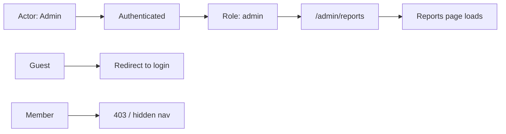
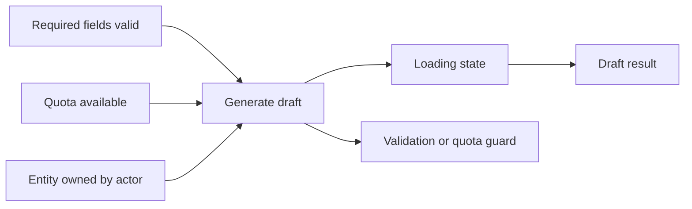
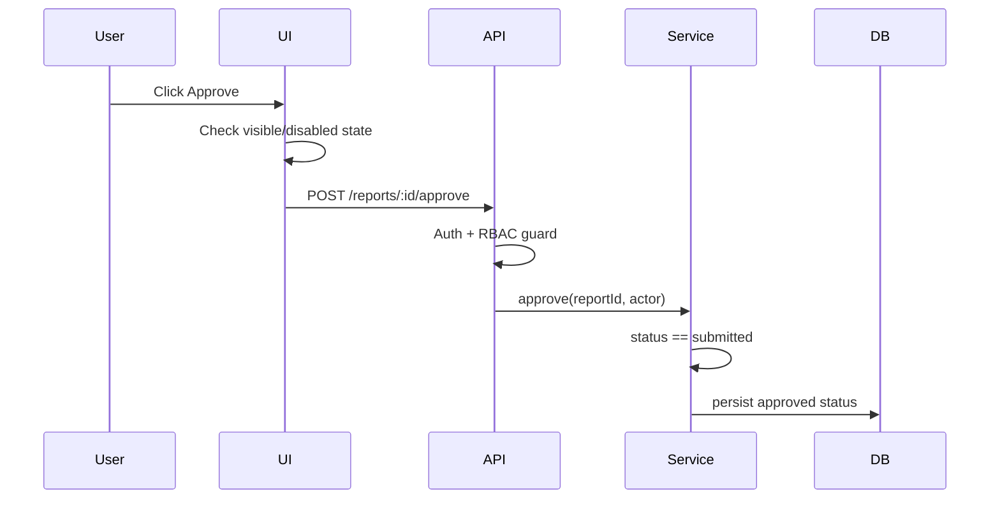

# Feature Intake Condition Inspect Protocol

Use this protocol when an intake package must explain page entry conditions,
action execution conditions, backend guards, data lifecycle requirements, or
role/permission boundaries.

Action evidence answers "what happens." Condition evidence answers "when, for
whom, and under which data state it can happen."

## Core Outputs

Condition inspect should produce human-readable tables, machine-readable data,
and visual graphs.

```text
docs/feature-intake/<slug>/
├── analysis/
│   ├── condition-graph.md
│   ├── condition-graph.json
│   ├── condition-visuals.md
│   ├── page-entry-conditions.md
│   ├── action-preconditions.md
│   └── server-guard-inventory.md
└── qa/
    └── condition-probe-matrix.md
```

Use all files for implementation-ready analysis. For smaller artifacts, write at
least `condition-graph.md` and note why the other outputs are not needed.

## Condition Sources

Inspect both frontend and backend. Frontend-only condition analysis is partial.

| Layer | Look For | Examples |
| --- | --- | --- |
| Frontend route | Page entry guard and redirects | protected route, loader, layout guard, auth wrapper |
| Frontend UI | Visibility and affordance condition | hidden button, disabled CTA, validation copy |
| Frontend form | Input validity and client preconditions | zod/yup schema, resolver, required field |
| API client | Request shape and caller-side precheck | mutation hook, server action call, fetch wrapper |
| Backend route | Authentication and request validation | middleware, controller guard, request schema |
| Backend authorization | RBAC, ownership, tenant, plan, quota | `requireAdmin`, owner check, org boundary |
| Service/use case | Business precondition | status transition, idempotency, duplicate check |
| Domain/data | Invariant and persistence constraint | enum lifecycle, unique index, foreign key, audit field |
| Tests/fixtures | Expected states already encoded | e2e setup, seeded roles, unit test edge cases |
| Runtime config | Environment-dependent access | feature flag, rollout flag, paid plan, model quota |

## Condition Graph Model

Represent each condition as a first-class node or edge.

| Node | Meaning |
| --- | --- |
| Actor | Role, user type, team, tenant, or system actor |
| Entry Point | Route, screen, modal, tab, deep link, or workflow entry |
| Entity State | Draft, submitted, approved, archived, empty, quota-exhausted |
| Condition | Boolean, threshold, lifecycle, ownership, role, feature flag |
| Guard | Code path that enforces or displays the condition |
| Target | Page, action, API, output, or transition controlled by the condition |
| Outcome | Allowed, hidden, disabled, redirect, 401, 403, 404, 409, validation error |

Recommended table for `analysis/condition-graph.md`:

| ID | Target | Condition | Layer | Guard/Evidence | Allowed Outcome | Blocked Outcome | Verification | Status | Next Probe |
| --- | --- | --- | --- | --- | --- | --- | --- | --- | --- |

Status values:

- `source-confirmed`: code shows the condition.
- `runtime-verified`: browser behavior confirms the condition.
- `server-verified`: direct API probing confirms server-side enforcement.
- `product-confirmed`: user/product owner confirmed the intended rule.
- `partial`: only one layer is confirmed.
- `unknown`: suspected but not evidenced.
- `decision-needed`: product rule is not decided.
- `blocked`: cannot verify with current access/data.

## Machine-Readable Data

Write `analysis/condition-graph.json` when the package will feed QA, tests, or
implementation planning.

Recommended shape:

```json
{
  "generatedAt": "2026-06-29T00:00:00.000Z",
  "conditions": [
    {
      "id": "C-001",
      "targetType": "page",
      "target": "/admin/reports",
      "condition": "actor.role == 'admin'",
      "layer": "backend-authz",
      "evidence": [
        { "type": "source", "path": "src/middleware/auth.ts", "line": 42 }
      ],
      "allowedOutcome": "page loads",
      "blockedOutcome": "403",
      "verification": ["source-confirmed"],
      "status": "partial",
      "nextProbe": "Open route as non-admin user"
    }
  ],
  "dependencies": [
    { "from": "actor:admin", "to": "condition:C-001", "type": "satisfies" },
    { "from": "condition:C-001", "to": "page:/admin/reports", "type": "allows" }
  ]
}
```

Use real timestamps. Do not use placeholder values.

## Visual Outputs

Write `analysis/condition-visuals.md` with Mermaid diagrams. Keep diagrams
small enough to review. Split by workflow when needed.

### Page Entry Dependency Graph

Use for route/screen access conditions.



### Action Precondition Graph

Use for button/API execution conditions.



### Frontend-Backend Enforcement Chain

Use when UI and server guards can diverge.



### Role/Data Matrix

Use a table when matrices are easier than graphs.

| Actor | Entity State | Page Entry | Generate | Save | Approve | Notes |
| --- | --- | --- | --- | --- | --- | --- |
| Guest | any | redirect | n/a | n/a | n/a | login required |
| Consultant | draft | allowed | allowed | allowed | hidden | approve requires reviewer |
| Reviewer | submitted | allowed | hidden | hidden | allowed | server guard needed |
| Admin | archived | allowed | disabled | disabled | disabled | restore decision needed |

## Page Entry Conditions

Write `analysis/page-entry-conditions.md` for routes, screens, modals, tabs, and
deep links.

For each entry point:

- route/screen identifier
- actor requirements
- authentication state
- role/permission/tenant/ownership requirements
- entity existence and lifecycle requirements
- feature flag, plan, quota, or environment requirements
- redirect, hidden, 401, 403, 404, empty, or fallback behavior
- source evidence and runtime evidence

## Action Preconditions

Write `analysis/action-preconditions.md` for user-visible commands and implicit
system events.

For each action:

- action ID from `analysis/action-graph.md`
- required actor and entity state
- required input validity
- client UI condition: visible, hidden, disabled, enabled
- backend execution condition
- failure status: validation error, 401, 403, 404, 409, quota, rate limit
- output/lifecycle implications
- source, screenshot, API probe, and product confirmation evidence

## Server Guard Inventory

Write `analysis/server-guard-inventory.md` when backend source or API behavior is
available.

Inventory:

- endpoint/handler
- middleware/auth guard
- request validation
- RBAC/permission check
- ownership/tenant check
- feature flag/plan/quota check
- service/domain precondition
- DB constraint
- error code and error body if visible
- tests that already cover the guard

## Probe Matrix

Write `qa/condition-probe-matrix.md` to plan or record verification.

Recommended probes:

- unauthenticated direct route entry
- wrong role direct route entry
- wrong owner/tenant entity access
- missing entity access
- each lifecycle state: draft, submitted, approved, archived
- invalid input
- quota exhausted
- feature flag disabled
- direct API call that bypasses UI
- duplicate/idempotent call

Recommended table:

| Probe ID | Target | Actor/Data State | Expected | Method | Evidence | Result | Status |
| --- | --- | --- | --- | --- | --- | --- | --- |
| P-001 | `/admin/reports` | guest | redirect login | browser | screenshot | not run | pending |
| P-002 | `POST /reports/:id/approve` | consultant + submitted | 403 | API | response log | not run | pending |

## Self-Audit Rules

Before packaging, check:

- every high-priority page has at least one entry condition row
- every high-priority action has at least one precondition row
- every frontend-only guard is marked `partial` until server enforcement is checked
- every backend-only guard notes whether the UI exposes, hides, or disables the action
- every condition graph row has source, runtime, API, product, blocker, or unknown evidence
- every visual graph reflects the same IDs used in the tables and JSON
- every probe has a clear expected result before it is run

Do not call access control "verified" from UI evidence alone.
