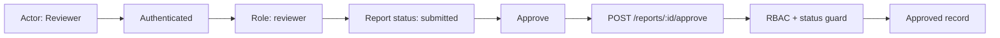

# Feature Intake Examples

## Natural Prompts

```text
이 PoC를 feature-intake 해줘.
스크린샷 포함해서 유저플로우, 유저저니, 유즈케이스, 제품 편입 분석까지 정리해줘.
외부 AI 호출은 mock 처리해줘.
```

```text
비즈니스팀에서 준 데모 앱이 있어.
모든 페이지와 버튼 클릭 후 상태를 캡처하고, 기존 서비스 어디에 붙이면 좋을지 분석해줘.
```

```text
시작 페이지부터 접근 가능한 페이지를 순회하면서 링크, 탭, 버튼, 모달, disabled/error 상태까지 스크린샷으로 남겨줘.
실제 저장/삭제/발송 같은 최종 액션은 누르지 말고 직전 상태까지만 봐줘.
```

```text
이 Figma prototype을 실제 제품 기능 후보로 intake 해줘.
사용자, 사용 맥락, output destination, quality bar, MVP/backlog까지 일반화해서 정리해줘.
```

```text
기존 feature-intake 결과를 스크린샷과 연결된 웹 리포트로 만들어줘.
Mermaid 다이어그램은 렌더링하고, 노드에서 해당 화면 근거로 이동할 수 있게 해줘.
```

## Product Framing Table

```md
## Product Framing

| Topic | Status | Finding | Evidence | Decision |
|---|---|---|---|---|
| Primary operator | Assumed | Customer success manager operates the workflow. | Screens show internal dashboard copy. | Confirm with product owner. |
| Output recipient | Unknown | Result destination is not visible. | No send/save action in artifact. | Decide save vs export vs send. |
| Quality bar | Decision Needed | AI output needs review before user-facing delivery. | Generated text is editable. | Define approval owner. |
```

## Screenshot Index

```md
## Screenshots

| Family | Screenshot | Notes |
|---|---|---|
| Page | screenshots/pages/01-dashboard.png | Entry state |
| Interaction | screenshots/interactions/04-generate-clicked.png | Loading and generated state |
| Dialog | screenshots/dialogs/02-copy-alert.png | Native copy confirmation |
| Edge | screenshots/edge-cases/03-invalid-file.png | Upload validation |
```

## Page Walk Command

```bash
node plugins/feature-intake/scripts/page_walk_capture.mjs \
  --base-url http://localhost:3000 \
  --routes /admin \
  --crawl-depth 1 \
  --out docs/feature-intake/admin-surface/screenshots
```

```md
## Page Walk Outputs

| Artifact | Purpose |
|---|---|
| screenshots/page-walk-results.json | Machine-readable route, target, screenshot, dialog, and blocker inventory. |
| screenshots/page-walk-index.md | Reviewer-friendly index of pages and interaction evidence. |
| screenshots/pages/ | Full-page screenshots for each reached route. |
| screenshots/interactions/ | Non-dialog interaction screenshots. |
| screenshots/dialogs/ | Modal and native dialog evidence. |
| screenshots/edge-cases/ | Disabled, skipped mutation, and click-error evidence. |
```

## Action Graph

```md
## Action Graph

| ID | Actor | Surface | State | Action | Trigger | Reaction | Destination/Output | Evidence | Status | Next Check |
|---|---|---|---|---|---|---|---|---|---|---|
| A-001 | Primary operator | Dashboard | configured | Generate draft | Generate button | async -> result | Draft content | screenshots/interactions/03-generate-result.png; src/App.tsx:88 | verified | Add failure capture |
| A-002 | Primary operator | Result modal | result | Copy output | Copy button | output | Clipboard text | screenshots/dialogs/04-copy-alert.png | captured | Decide persistence |
| A-003 | Reviewer | Result view | review | Approve | Approve button | mutation | Approved record | src/review.ts:42 | source-confirmed | Capture with disposable data |
```

## Condition Graph And Visuals

```md
## Condition Graph

| ID | Target | Condition | Layer | Guard/Evidence | Allowed Outcome | Blocked Outcome | Verification | Status | Next Probe |
|---|---|---|---|---|---|---|---|---|---|
| C-001 | /admin/reports | actor.role == admin | backend-authz | src/middleware/auth.ts:42 | page loads | 403 | source-confirmed | partial | Open as member |
| C-002 | A-001 Generate draft | required fields valid and quota available | frontend+backend | src/schema.ts:18; src/quota.ts:31 | loading -> result | disabled or quota guard | runtime-verified | partial | Direct API quota probe |
```



```md
## Condition Probe Matrix

| Probe ID | Target | Actor/Data State | Expected | Method | Evidence | Result | Status |
|---|---|---|---|---|---|---|---|
| P-001 | /admin/reports | guest | redirect login | browser | screenshot | not run | pending |
| P-002 | POST /reports/:id/approve | consultant + submitted | 403 | API | response log | not run | pending |
```

## Spec Extraction Audit

```md
## Spec Extraction Audit

| Area | Pass | Gap | Blocked | Notes |
|---|---:|---:|---:|---|
| High-priority actions | 8 | 1 | 1 | Approval mutation needs disposable data. |
| User-flow steps | 6 | 0 | 0 | All steps reference action IDs. |
| Output destinations | 1 | 1 | 0 | Copy is captured; save/send decision needed. |
| Async states | 2 | 1 | 0 | Failure state not captured yet. |
```

## Static Web Report

```md
## Report Outputs

| Artifact | Purpose |
|---|---|
| report.html | Reviewer-facing planning document with screenshot-backed sections. |
| docs/index.html | Purpose-based source-document entry point. |
| docs/*.html | Readable HTML version of each source Markdown document. |
| docs/all.html | Optional all-in-one search/scan page. |
| docs/assets/mermaid.min.js | Local Mermaid runtime for file-based review packages. |
```

## Use Case Table

```md
## Use Cases

| ID | Actor | Goal | Trigger | Main Flow | Exceptions | Output |
|---|---|---|---|---|---|---|
| UC-01 | Primary operator | Generate draft plan | Click Generate | Input data -> AI draft -> review | Missing data, AI error | Draft result |
| UC-02 | Reviewer | Approve or edit output | Open result | Read -> edit -> approve | Low confidence | Approved result |
```

## MVP Boundary

```md
## MVP Proposal

### Include
- Core input flow
- Main generation action
- Editable result
- Export or save destination
- Basic error handling

### Defer
- Admin analytics
- Bulk processing
- Multi-version comparison

### Remove
- Prototype-only debug controls

### Decision Needed
- Whether output is internal draft or customer-facing deliverable
```

## Integration Fit

```md
## Integration Fit

| Existing Surface | Fit | Rationale | Work Needed |
|---|---|---|---|
| Entity detail tab | Strong | Artifact depends on one existing entity. | Add tab, query entity context. |
| Standalone tool page | Medium | Works for batch mode but weaker context. | Add selector/search. |
| Admin console | Weak | End users need outcome, not admins only. | Not recommended for MVP. |
```
